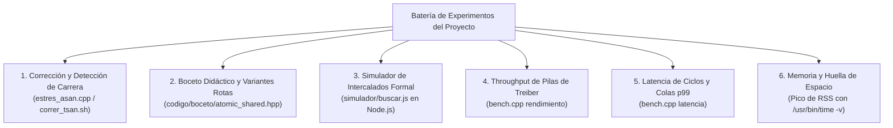

# Gran Guía Completa de los Experimentos y Códigos del Proyecto

> **Paper de Referencia:** *«A Fast Wait-Free Solution to Read-Reclaim Races in Reference Counting»* (Euro-Par 2024).  
> **Equipo del Proyecto:** David Tamo Turpo, Jheremy Manuel Alvarez Astete y Diego Quispe Candelario.  
> **Ubicación de Guías Individuales:** `~/Escritorio/guias_experimentos/`

---

## 0. Mapa General de la Batería de Experimentos

El proyecto valida las afirmaciones teóricas y experimentales del paper mediante seis componentes de código independientes:

---

## 1. Experimento 1: Carrera *Read-Reclaim* con AddressSanitizer y ThreadSanitizer

### 1.1. Explicación Detallada (Rigor Técnico)
* **Código:** `codigo/estres_asan.cpp` y `codigo/correr_tsan.sh`.
* **Qué hace:** Lanza 8 hilos ejecutando 200,000 operaciones sobre un puntero compartido con 10% de escrituras y 90% de lecturas.
* **El Problema en la Versión Ingenua:** El método `load()` lee el puntero y luego incrementa el contador del objeto en dos pasos independientes (`cartel.load()`, `yield()`, `l->rc.fetch_add(1)`). Un escritor intermedia y ejecuta `delete` sobre el objeto viejo. El lector despierta e intenta escribir en memoria liberada.
* **Diagnóstico de AddressSanitizer:** ASan detecta inmediatamente **`heap-use-after-free`** en la dirección del objeto, reportando la línea exacta donde el hilo `T2` liberó la memoria y la línea donde el hilo `T1` intentó escribir.
* **Resultado del Código de los Autores:** Ejecuta **1,600,000 operaciones en 56 milisegundos con CERO errores de memoria**, demostrando que su `load()` de un solo `fetch_sub` atómico erradica la carrera por completo.

### 1.2. Versión Dummie (Para Principiantes)
* **La Analogía:** El inspector de sanidad de la cocina. Ana saca un pollo crudo pero se distrae atándose los cordones; Beto tira el pollo vencido al incinerador; Ana intenta cocinar el aire vacío donde estaba el pollo. El inspector de sanidad hace sonar una sirena roja escandalosa y detiene el restaurante.
* **En 3 Balas:**
  1. ¿Qué prueba? Que la carrera *read-reclaim* es real y mortal en el código ingenuo.
  2. ¿Qué pasa con los autores? Corre 1.6 millones de veces sin un solo fallo en 56 milisegundos.
  3. ¿Cómo se corre? `./bin/estres_asan ingenua` para ver el choque rojo, y `./bin/estres_asan autores` para ver la perfección.

---

## 2. Experimento 2: El Boceto Didáctico y las Variantes Rotas

### 2.1. Explicación Detallada (Rigor Técnico)
* **Código:** `codigo/boceto/atomic_shared.hpp` y `codigo/boceto/prueba.cpp`.
* **Técnica:** Empaqueta en un entero de 64 bits los 48 bits inferiores de dirección virtual y los 16 bits superiores de peso ($C$).
* **Regla R-1 ($C \ge 2P$):** Garantiza que aun cuando los $P$ hilos decidan bajar el peso simultáneamente, el peso en la celda no bajará de cero.
* **Regla R-2 (Salida Temprana):** Si un hilo entra a `increase_weight()` y su CAS falla porque el peso observado es mayor al que tenía, significa que otro hilo ya recargó. El hilo devuelve su reserva previa y sale inmediatamente.
* **Resultados de las Variantes Rotas:**
  * **Boceto Normal:** 0 errores de memoria; máximo 7 intentos de CAS ($\le P = 8$). Es rigurosamente *Wait-Free*.
  * **Variante `SIN_SALIDA`:** 0 errores inmediatos, pero el máximo de intentos de CAS **explota a 38 intentos** ($> P=8$), perdiendo la garantía *wait-free*.
  * **Variante $C = P$ ($VAR\_C=8$):** Desencadena **50,060 errores de memoria** y 3,055 dobles liberaciones por subdesborde (*underflow*).

### 2.2. Versión Dummie (Para Principiantes)
* **La Analogía:** La billetera con truco de magia. En la misma tarjeta tienes escrita la cantidad de pizzas y la dirección de la fiesta.
* **En 3 Balas:**
  1. ¿Qué pasa si compras pocas pizzas ($C=P$)? La gente se queda con hambre y se desata una pelea campal (50,000 errores de memoria).
  2. ¿Qué es la salida temprana? Si vas a comprar pizzas y ves que tu amigo ya trajo 3 cajas familiares, te regresas a la fiesta contento en vez de ser terco y hacer 38 viajes inútiles.
  3. ¿Qué demuestra? Que las dos reglas matemáticas del paper son obligatorias para que no se rompa el programa.

---

## 3. Experimento 3: Simulador de Intercalados y Contraejemplos Mínimos

### 3.1. Explicación Detallada (Rigor Técnico)
* **Código:** `simulador/buscar.js` y `simulador/paper_motor.js` (Node.js).
* **Metodología:** Verificación formal estocástica (*Model Checking*) que intercala micro-pasos atómicos en todos los órdenes posibles durante 20,000 ejecuciones con 3 hilos ($P=3, C=6$).
* **Invariantes Verificadas en Cada Paso:** $peso \ge 0$; $rc(L) \ge peso + \sum pases$; ningún acceso a objetos muertos.
* **Hallazgos:**
  * **Paper:** **0 fallos en 20,000 ejecuciones.**
  * **Ingenua:** 4,796 fallos (uso tras liberar, contraejemplo más corto en 6 pasos).
  * **Umbral 0:** 5,089 fallos (peso negativo, contraejemplo en 2 pasos).
  * **Sin Reserva:** 1,171 fallos (liberación prematura, contraejemplo en 6 pasos).
  * **Sin Salida Temprana:** 5,467 fallos (desborde de peso, contraejemplo en 7 pasos).
* **Validación con 4 Hilos ($P=4$):** El 100% de los intentos de recarga terminaron en $\le 4$ intentos (1 intento: 80.1%, 2: 18.2%, 3: 1.7%, 4: 0.06%).

### 3.2. Versión Dummie (Para Principiantes)
* **La Analogía:** La pista de pruebas de choques de autos. Ponemos a 3 conductores ciegos a manejar en una pista caótica 20,000 veces.
* **En 3 Balas:**
  1. ¿Qué hace el simulador? Genera el peor orden posible de eventos para ver si el código resiste el caos.
  2. ¿Quién sobrevive? El algoritmo del paper sobrevive 20,000 pruebas extremas sin un solo choque.
  3. ¿Qué le pasa a las demás? Chocan y explotan en apenas 2 a 7 pasos de reloj.

---

## 4. Experimento 4: Benchmark de Rendimiento de Pilas Concurrentes de Treiber

### 4.1. Explicación Detallada (Rigor Técnico)
* **Código:** `codigo/bench.cpp` (Modo `rendimiento`).
* **Estructura:** Pila de Treiber concurrente sobre punteros atómicos compartidos con 6 configuraciones de contención ($n=1, 10, 100000$ pilas; $u=1\%, 10\%, 50\%$ actualizaciones push/pop).
* **Resultados con 12 hilos ($n=1, u=1\%$):**
  * **Autores:** **39.13 Mop/s**.
  * **Mutex:** **6.07 Mop/s**.
  * **Williams:** **5.34 Mop/s**.
  * **Libstdc++:** **1.58 Mop/s**.
  * *Factor:* El autor es **25× más rápido que GCC** y **7.3× más rápido que Williams**.
* **El Matiz Honesto ($n=1, u=50\%$):** Con contención extrema de escritura en una sola celda, el Mutex supera al autor (2.91 vs 2.32 Mop/s) porque el `compare_and_set` del autor es Lock-Free y sufre reintentos mientras que el Mutex serializa en orden estricto.

### 4.2. Versión Dummie (Para Principiantes)
* **La Analogía:** La torre de platos en el buffet con 12 camareros.
* **En 3 Balas:**
  1. ¿Qué mide? Cuántos millones de platos por segundo pueden leer o mover los camareros.
  2. ¿Quién arrasa en el 99% de las situaciones? El autor con 39.1 millones de operaciones por segundo, dejando en ridículo a GCC y Williams.
  3. ¿Cuándo gana el candado viejo? Solo cuando todos se pelean a puñetazos por mover el mismo plato al mismo segundo ($u=50\%$).

---

## 5. Experimento 5: Benchmark de Latencia y Estudio de Colas ($p99$)

### 5.1. Explicación Detallada (Rigor Técnico)
* **Código:** `codigo/bench.cpp` (Modo `latencia`).
* **Metodología:** Medición en nanosegundos mediante la instrucción x86 `__rdtsc` serializada con barreras `_mm_lfence()`, calibrando ticks frente al reloj monotónico de Linux.
* **La Revelación de los Percentiles ($p=12$ hilos, operación `load`):**
  * **Autores:** Mediana = **269 ns** | Percentil 99 ($p99$) = **830 ns (0.83 µs)**.
  * **Libstdc++:** Mediana = **3,061 ns** | Percentil 99 ($p99$) = **16,012 ns (16.0 µs)**.
  * **Mutex Convencional:** Mediana = **61 ns** | Percentil 99 ($p99$) = **27,641 ns (27.6 µs)**.
* **Conclusión Formal:** El Mutex tiene una mediana baja porque sin disputa toma ~20 ns en caché L1; pero cuando 12 hilos colisionan, el perdedor cae a `sys_futex` y context switch en el kernel Linux, demorando **más de 27 microsegundos**. El autor garantiza una cola compacta sub-microsegundo ($p99 < 1 \mu\text{s}$).

### 5.2. Versión Dummie (Para Principiantes)
* **La Analogía:** La fila del supermercado.
* **En 3 Balas:**
  1. ¿Por qué la mediana engaña? Porque el candado parece rápido cuando estás solo (61 nanosegundos), pero a la hora punta el último de la fila espera 27 minutos (27.6 microsegundos).
  2. ¿Qué ofrece el autor? Un torniquete automático que siempre tarda lo mismo: el 99% de las personas pasa en menos de 1 microsegundo.
  3. ¿Para qué sirve esto en la vida real? Para que los videojuegos no tengan tirones (*microstuttering*) y los servidores bancarios no tengan lag repentino.

---

## 6. Experimento 6: Medición de Memoria (Pico de RSS)

### 6.1. Explicación Detallada (Rigor Técnico)
* **Comando:** `/usr/bin/time -v ./bench rendimiento 1.0`
* **Métrica:** *Maximum Resident Set Size* (RSS en kilobytes).
* **Teoría:** Evalúa la propiedad de **Cero Sobrecoste de Memoria**. Métodos rivales como Anderson (CDRC) usan punteros de riesgo y retienen objetos en listas de retiro (*retire lists*), inflando la memoria RAM. El autor libera inmediatamente en cuanto $rc = 0$, manteniendo un RSS idéntico al de punteros secuenciales clásicos.

### 6.2. Versión Dummie (Para Principiantes)
* **La Analogía:** Pesar a los corredores en una balanza.
* **En 3 Balas:**
  1. ¿Qué mide? Cuántos megabytes de memoria RAM física se come el programa mientras corre a máxima velocidad.
  2. ¿Por qué el autor no engorda? Porque en cuanto termina de usar una variable, la bota al tacho de basura en ese mismo instante.
  3. ¿Qué le pasa a los otros? Otros rivales acumulan bolsas de basura en el pasillo, inflando la memoria RAM innecesariamente.
